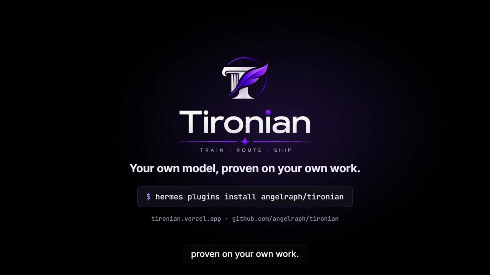
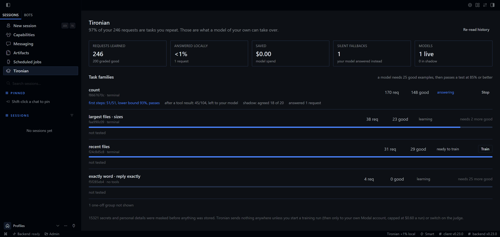
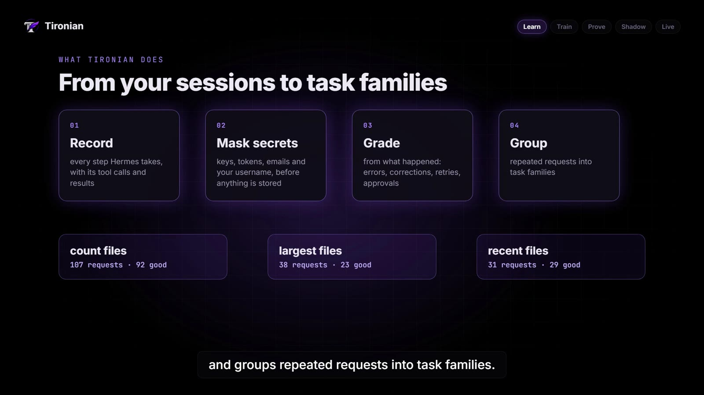
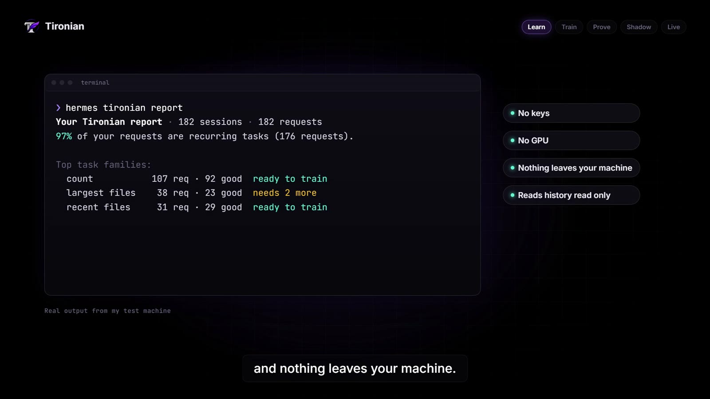
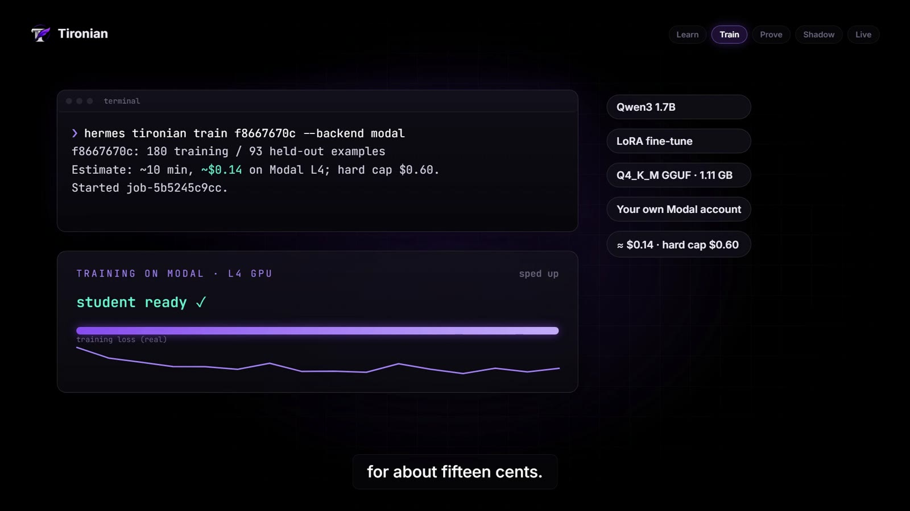
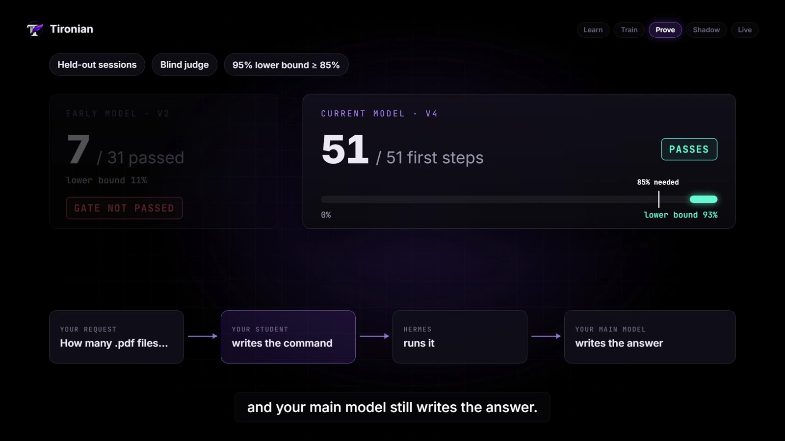
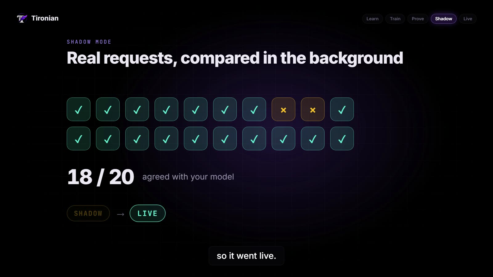
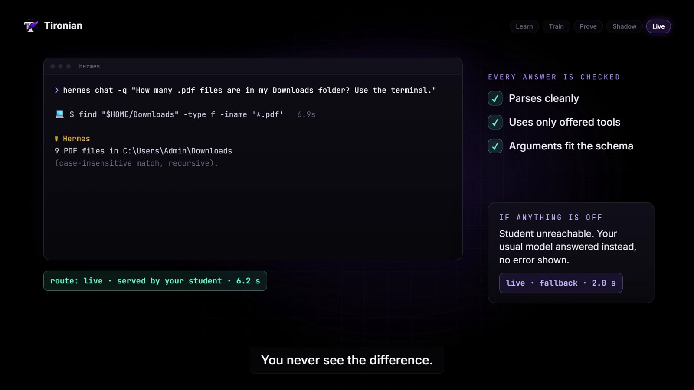
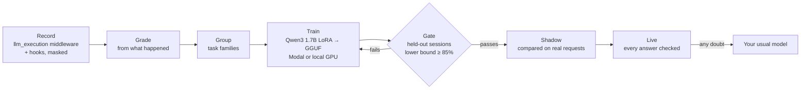

# Tironian

**Your own small model, learned from your own Hermes work.**

Tironian is a plugin for Hermes Agent. It records the work you already do with Hermes, notices the
requests you keep repeating, and fine-tunes a small model of your own for each of them. That model
only gets to help after it proves itself on sessions it has never seen, then on real requests in
shadow mode. Every answer it gives is checked, and if anything is off, your usual model answers
instead and you never see the difference.

[**Live site: tironian.vercel.app**](https://tironian.vercel.app) · [**Demo video (1:26)**](https://tironian.vercel.app/#demo) · [Catalog PR](https://github.com/NousResearch/hermes-agent/pull/151281) · [Submission](SUBMISSION.md) · [Internal review](AUDIT.md) · [Changelog](https://tironian.vercel.app/changelog) · [Docs](https://tironian.vercel.app/docs)

[](https://tironian.vercel.app/#demo)

*Watch the 1:26 demo. Every number in it comes from real runs on my laptop, and the last scene is
the real Tironian page inside Hermes. How it was made is in [demo/](demo/).*

[](https://github.com/angelraph/tironian/actions/workflows/ci.yml)

Built for the Nous Research **Hermes Agent plugin hackathon**.

## At a glance

| | |
|---|---|
| **What it is** | A Hermes plugin that distills your own sessions into a small local model per task, and routes those tasks to it once it has proven itself |
| **Student model** | Qwen3 1.7B, LoRA fine-tune, exported as a 1.11 GB Q4_K_M GGUF, served by Ollama or Hermes's local model server |
| **Training** | On a GPU in your own Modal account: my runs took about 10 minutes and cost $0.14, with a hard cap. Or free on your own NVIDIA GPU |
| **The gate** | Held-out sessions, a blind judge for differing answers, and the 95% Wilson lower bound must reach 85%, judged separately for first steps and steps after a tool result |
| **Live result** | First steps **51 of 51** on held-out sessions (lower bound 93%), **18 of 20** agreement in shadow mode, now answering live |
| **Safety net** | Every answer must parse, call only offered tools and fit their schemas, or your usual model answers, silently. Spot checks on live requests catch drift, and one correction sends a student back to shadow |
| **Hermes surfaces** | `llm_execution` middleware, 10 hooks, `/tironian`, `hermes tironian`, an auxiliary model slot, a Desktop page and status chip, a dashboard API |
| **Tests** | 81 tests, CI on Linux and Windows with Python 3.11 to 3.14, `hermes plugins validate` and `doctor` clean |
| **Privacy** | Secrets and personal details masked before storage, history read only, nothing sent anywhere until you start a training run |

## Contents

- [The idea in one minute](#the-idea-in-one-minute)
- [Proven on my machine](#proven-on-my-machine)
- [Why Tironian](#why-tironian)
- [Product tour](#product-tour)
- [How it works](#how-it-works)
- [The gate](#the-gate)
- [What it promises](#what-it-promises)
- [What it reads, stores and sends](#what-it-reads-stores-and-sends)
- [Quickstart](#quickstart)
- [Architecture](#architecture)
- [Verification](#verification)
- [Build log](#build-log)
- [Repository layout](#repository-layout)
- [Risks and limits](#risks-and-limits)

## The idea in one minute

A lot of what I ask Hermes is the same handful of things in different words: which files are
eating my disk, how many PDFs are in some folder, what changed recently. Each time, a large hosted
model does the job from scratch, and the exchange is thrown away afterwards.

Hermes already has the two pieces needed to do better. It records conversations in Nous's own
Hermes function calling format, and it can run GGUF models locally. Tironian connects them:

| Hermes already has | Tironian turns it into |
|---|---|
| Every model step, through the `llm_execution` middleware | A masked, graded record of your own work |
| Tool results, approvals, corrections | A grade for every turn, from what actually happened |
| Requests you repeat in different words | Task families, found by plain deterministic code |
| The Hermes function calling format | Training data that matches serving exactly |
| A local model runtime | A student that answers on your own machine |

The name comes from Tiro, Cicero's secretary. He learned his master's work well enough to invent
a shorthand for it and keep it going.

## Proven on my machine

A laptop with no GPU (Intel HD 620, 16 GB), Hermes with a free hosted model, the student served by
Ollama on the CPU. The family is "count the files of a type in a folder".

| Step | Result | Where to check |
|---|---|---|
| Training on a Modal L4 | 180 examples, 46 steps, about 10 minutes, $0.14 | [train scene](media/train.jpg) |
| Early student (v2) | 7 of 31 held-out steps, lower bound 11%: **refused by the gate** | [gate scene](media/gate.jpg) |
| Current student (v4), first steps | **51 of 51**, lower bound **93%**: passes | [gate scene](media/gate.jpg), [Hermes page](media/hermes-page.png) |
| Current student (v4), after a tool result | 45 of 104: stays with my usual model | [Hermes page](media/hermes-page.png) |
| Shadow mode, real requests | **18 of 20** agreed, so it went live | [shadow scene](media/shadow.jpg) |
| Live request | First step written by the student in 6.2 s, answer by my usual model | [live scene](media/live.jpg) |
| Student unreachable | My usual model answered, nothing shown to me, logged as a fallback | [live scene](media/live.jpg) |

The held-out steps include 62 from sessions recorded after training, which the student had never
seen. Most sessions were seeded with [`scripts/seed_sessions.py`](scripts/seed_sessions.py), which
runs real `hermes chat` turns with my own model, so I had enough repeated work to learn from in a
few days. The full story, bugs included, is in the [build log](#build-log) and the
[changelog](https://tironian.vercel.app/changelog).

## Why Tironian

| | |
|---|---|
| **What's new** | Routers pick between existing models; Tironian makes a new one that knows your work. It is trusted one kind of step at a time, so a small model that writes the right command but can't yet read the result still takes the part it has mastered, and your model does the rest. |
| **Never worse than today** | A student only serves the kinds of step it has passed, after shadow mode. Every answer is validated, any doubt hands the turn back to your usual model, and a model that falls back too often demotes itself. |
| **Honest numbers** | The gate uses the lower end of a 95% confidence interval, not an average. It turned down my early model at 7 of 31, and the demo shows that refusal next to the pass. |
| **Built on Hermes, not around it** | Uses the public plugin surfaces only: middleware, hooks, a slash command, a CLI command, an auxiliary model slot, plugin storage, the secret store, a Desktop page and chip. No patches to Hermes, standard library only in process. |
| **Cheap to try** | The first report needs no keys and no GPU. A training run costs about $0.15 with a hard cap, or nothing on your own GPU. |
| **Private by default** | Secrets, emails, card numbers and your username are masked before anything is stored. Your history is read read only. Nothing leaves the machine until you start a training run. |

## Product tour

**Inside Hermes.** The Tironian page in Hermes Desktop (here in the Hermes web app): requests
learned, what ran locally, silent fallbacks, and every task family with its test result, shadow
agreement and a Train, Shadow, Let it answer or Stop button. The status bar chip shows how much is
answered locally.



**What it does.** Record every step, mask secrets, grade how each turn went, group repeated
requests into task families.



**The first report** comes from the history you already have, read only.



**Training** runs on a GPU in your own Modal account, with the cost shown first and a hard cap.



**The gate** tests the student on sessions it has never seen. Each kind of step is judged on its
own, so a student that writes the right command but can't yet summarise the result serves just
the command, and your model writes the answer.



**Shadow mode** runs the student on real requests in the background and compares it with your
model before it is trusted.



**Live, with fallback.** The routine part runs on your machine. Every answer is checked, and
anything off goes to your usual model.



## How it works



1. **Record.** The `llm_execution` middleware captures each model step; hooks record tool
   outcomes, approvals, interrupts and session boundaries. Secrets and personal details are
   masked before anything is written to disk.
2. **Grade.** Each turn is scored from what actually happened: did the commands succeed, did you
   correct it or ask again, did you deny an approval, did you mark it with `/tironian good` or
   `bad`. When in doubt, a turn is not learned from.
3. **Group.** Recurring requests become task families. This part is plain, deterministic code, so
   the same history always gives the same families.
4. **Train.** For a family with enough good examples, Tironian fine-tunes Qwen3 1.7B with LoRA and
   exports a quantized GGUF. The training prompt is built by the same code the router uses when
   serving, down to Qwen3's empty think block.
5. **Prove.** See [the gate](#the-gate).
6. **Route.** Matching requests go to the student. Its answer has to parse, call only tools the
   request actually offers, and pass those tools' argument schemas. If any of that fails, your
   usual model answers instead.

## The gate

The student answers every held-out step, given exactly the context your model had. A step passes
when the output parses, takes the same kind of action, calls the same tools with matching
arguments, and for a final answer is preferred or tied by a blind judge. When the student's command
differs from your model's (`find` against `ls`, say), the same blind judge decides whether both do
the job.

Then comes the decision. Tironian computes the **Wilson score interval** for the pass rate and
looks at its **lower** end. Ten out of ten sounds perfect, but its lower bound is only 72%,
because ten examples prove very little. The default gate needs a lower bound of 85%, at least 30
steps and 98% format validity.

The first step of a task and the steps after a tool result are scored **separately**, each with
its own minimum and its own bound. Small models are often good at the first and shaky at the
second, so a student can serve just the first step and your model writes the answer from the
output. Sessions you record after training were never seen either, so they join the test too: run
`eval` again later and the evidence grows without training again.

## What it promises

- Your normal model is called at most once per request. If something inside Tironian fails before
  that call, the request goes to your model unchanged. If something fails after it, your model's
  answer is returned.
- A small model's answer is only used if it parses, uses an offered tool, and passes that tool's
  schema.
- After one fallback in a turn, or after any tool step fails or is blocked, your model finishes
  the turn. Recovering from a failed step is exactly what a small model is worst at.
- Hermes's own guardrails and approvals apply to the small model's tool calls the same way they
  apply to your model's.
- A live model drops back to shadow mode if more than 10% of its last 50 requests fell back, or
  the first time you correct, re-ask or deny a turn it took part in.
- About 1 in 10 of a live family's requests are spot checks: your usual model answers as before,
  and the student is judged against it in the background. If it agrees on fewer than 85% of its
  last 20, it goes back to shadow mode by itself. That is how a task that changes after training
  gets noticed.
- After any status change, the evidence starts again. A student sent back to shadow mode has to
  earn its way back with new agreements, not old ones.
- /tironian forget (or deleting the chat in Hermes) forgets a session exactly: its data is
  deleted, and any student that trained on it stops answering until it is retrained without it.
- Only steps your own model produced, in turns graded good, are used for training. A small model
  never learns from another small model.

## What it reads, stores and sends

This is the disclosure the Hermes plugin catalog asks for.

**Reads.** Your profile's `state.db`, opened read only, on first use and when you run
`hermes tironian import`. Nothing is written to it.

**Stores.** A SQLite database and job folders in `<HERMES_HOME>/plugin-data/tironian/`. That
includes masked request contexts and responses, tool results, grades, datasets and trained GGUF
files. Contexts older than `retention_days` (90 by default) are dropped. Deleting a session in
Hermes deletes it here too. `hermes tironian purge` deletes everything, and `/tironian off` stops
recording in the current conversation and excludes what was already recorded.

**Masks before storing.** API keys and tokens (OpenAI, Anthropic, OpenRouter, GitHub, AWS, Slack,
Google, Stripe, Hugging Face, Modal), JWTs, private keys, bearer tokens, passwords in URLs,
`password=` style values and other long random strings; email addresses, phone numbers, card
numbers, IBANs; your home folder and login name. A step with more than five masked secrets or
personal details is never used for training.

**Network.** Nothing during normal use. The router only talks to `student_endpoint`, which is
Hermes's local model server at `http://127.0.0.1:8080/v1` by default, or Ollama on
`http://127.0.0.1:11434/v1` when only Ollama has the model. Both stay on your machine. Only when
you start a training run does Tironian's separate trainer process upload that family's masked
training set to a private Volume in your own Modal account, train there, download the model and
delete the job's files from the Volume. The optional judge, off by default, sends held-out
examples to whichever model you assign to the "Tironian judge" slot. While a family is in shadow
mode it also sends that model the request and both answers when they differ, up to
`judge_daily_budget` calls a day.

**Processes and installs.** `hermes tironian trainer setup` creates a venv inside the plugin's data
folder and installs the `modal` client from PyPI (`--local` also installs the training
libraries). Training runs as a separate process in that venv, and only when you start it. Cron
jobs, the gateway and model turns never start training. Shadow mode uses one short background
thread at a time.

**Credentials.** The Modal token is read through Hermes's secret store and passed only to the
trainer process. Tironian never writes it to disk.

**Telemetry.** None.

## Quickstart

```bash
hermes plugins install angelraph/tironian
hermes plugins enable tironian
```

Then in any Hermes session:

```
/tironian report      what keeps coming up in your history, and what it costs
/tironian families    the task families and what each one still needs
/tironian             current status
```

On first use Tironian reads your existing Hermes history (read only), so the report already has
something in it. That step needs no keys, no GPU and costs nothing.

**Training a model**

```bash
hermes tironian trainer setup        # creates Tironian's own venv with the Modal client
hermes tironian trainer check        # checks your Modal token; uses no compute
hermes tironian train <family> --follow
```

Put your Modal token in Settings, Plugins, Tironian, or add `MODAL_TOKEN_ID` and
`MODAL_TOKEN_SECRET` to Hermes's `.env`. Each run is limited by `max_usd_per_run` (default $1.00),
which Tironian enforces as a timeout on the GPU job. To train on your own GPU instead, set
`train_backend: local` and run `hermes tironian trainer setup --local`.

When training is done, Tironian loads the model for you. If you run Ollama, it registers the model
there with the same prompt format it was trained on. Hermes's own local model server works too, or
point `student_endpoint` at any other OpenAI-compatible server. Then:

```bash
hermes tironian eval <student>       # test it on held-out steps from your own sessions
hermes tironian shadow <family>      # it answers in the background and gets compared
hermes tironian promote <family>     # after it has agreed with your model often enough
```

Finally, switch on "Let promoted students answer" in the plugin settings.

## Architecture

| Part | File |
|---|---|
| Recording and routing (the `llm_execution` middleware) and hooks | [`plugin/core/engine.py`](plugin/core/engine.py) |
| Masking secrets and personal details | [`plugin/core/redact.py`](plugin/core/redact.py) |
| Grading turns | [`plugin/core/grade.py`](plugin/core/grade.py) |
| Task families | [`plugin/core/families.py`](plugin/core/families.py) |
| Hermes function calling format, shared by training and serving | [`plugin/core/hermes_format.py`](plugin/core/hermes_format.py) |
| Datasets, held-out tests, the promotion gate | [`plugin/core/pipeline.py`](plugin/core/pipeline.py), [`plugin/core/evaluate.py`](plugin/core/evaluate.py) |
| Loading students into Ollama | [`plugin/core/serve.py`](plugin/core/serve.py) |
| Training (Unsloth LoRA to GGUF, on Modal or a local GPU) | [`plugin/trainer/`](plugin/trainer/) |
| Desktop page and status chip | [`plugin/desktop/plugin.js`](plugin/desktop/plugin.js) |
| Dashboard API | [`plugin/dashboard/plugin_api.py`](plugin/dashboard/plugin_api.py) |

Tironian only uses public plugin surfaces. It doesn't patch Hermes, and the part that runs inside
Hermes uses only the Python standard library.

## Verification

- **Tests:** 81, covering redaction, grading, clustering, the dataset split, the per-step Wilson
  gate, the judge, and every routing fallback path (malformed output, unknown tool, schema
  failure, server error, timeout, sticky fallback, hand-back after a blocked tool, auto-demotion,
  shadow mode, spot checks and drift, exact forgetting). CI runs them on Linux and Windows, Python 3.11 to 3.14.
- **Hermes checks:** `hermes plugins validate` (including the security scan) and
  `hermes plugins doctor --ci` pass at the pinned catalog SHA.
- **Live, on Windows with Hermes v0.22.7 and v0.23.0:** capture of streaming turns, four real
  training runs on Modal, the gate refusing and then passing a student, shadow mode, a live routed
  turn, and a live fallback with the student unreachable.
- **Internal review:** [AUDIT.md](AUDIT.md) lists what I checked, what I found and what I fixed.
  It is my own review, not a third-party audit.

```bash
python -m pytest tests -q
hermes plugins validate plugin
hermes plugins doctor plugin --ci
```

## Build log

| Date | What happened |
|---|---|
| Nov 5 | First version: capture with masking, grading, families, the exporter, Modal and local training, the held-out gate, shadow and live routing with fallback, `/tironian` and the CLI |
| Nov 6 | Tested on a real Hermes install. Desktop page and status chip. Fixed a leaky trainer environment, duplicate history imports, and families split by folder names |
| Nov 7 | First real students on Modal. Students load into Ollama on their own. The per-step gate and the judge for differing commands. Grouping fixed for when one task dominates history |
| Nov 8 | v4 passes the gate (51 of 51), goes through shadow mode (18 of 20) and goes live. Fixed shadow mode needing the answer switch, the judge budget and timeouts, cold starts, and the page showing a misleading score. Demo video, submission. Then, from a question on X: spot checks that catch drift, one correction sends a student back, exact forgetting, and students kept loaded between requests |

Every fix has a commit with the reason in it, and the plain-words version is on the
[changelog](https://tironian.vercel.app/changelog).

## Repository layout

```
plugin/             the plugin itself (the catalog points here)
  core/             capture, grading, families, datasets, gate, routing, CLI
  trainer/          the Modal and local GPU trainer (runs in its own venv)
  desktop/          the Hermes Desktop page and status chip
  dashboard/        the dashboard API
tests/              81 tests with a fake Hermes context and a fake model server
scripts/            seed_sessions.py, which runs real Hermes sessions to seed a family
demo/               the demo video: script, narration, motion graphics, transcript
media/              screenshots used in this README
web/                the site at tironian.vercel.app
submission/         the catalog entry and PR text
```

## Risks and limits

- **Speed on a CPU.** On my laptop with no GPU the student takes about 6 seconds for a step. The
  win there is cost and privacy, not speed. With a GPU it is faster than a hosted model.
- **First steps only, for now.** My student passed on first steps, not on steps after a tool
  result, so my usual model still writes the final answers. The gate decides this per family, and
  a better student will earn more.
- **Needs repetition.** A family needs about 25 good examples before it can be trained. If your
  work doesn't repeat, Tironian will mostly report and wait.
- **Spot checks cost a little.** By default 1 in 10 of a live family's requests still go to your
  usual model, to catch drift. Set spot_check_rate lower to save more, or 0 to turn it off.
- **Seeded data.** My results come from sessions I ran on purpose to build up examples quickly.
  They are real Hermes turns, but they are more uniform than everyday use.
- **Tested on Windows.** The live runs were on Windows. CI covers Linux and Windows; macOS is
  untested.

## License

MIT
